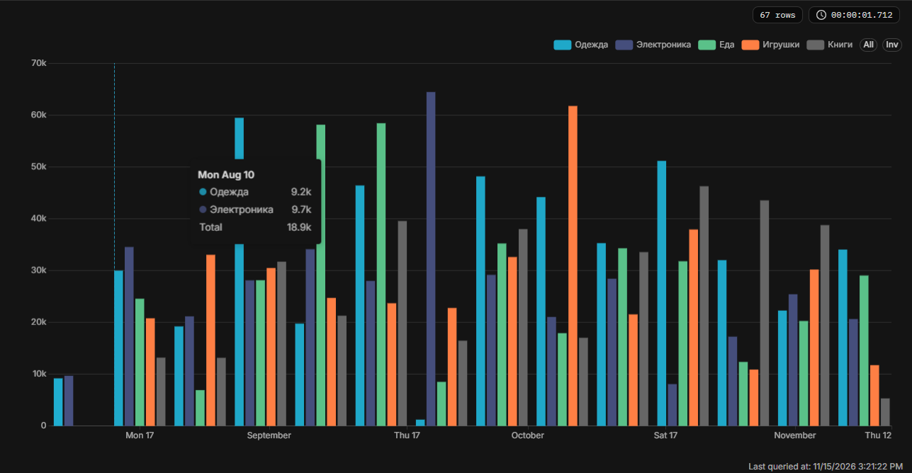

# Batch & Streaming Data Pipeline

End-to-end data engineering project demonstrating **batch data processing, real-time CDC streaming, orchestration, data transformation and analytical storage**.

The project combines PostgreSQL, Debezium, Apache Kafka, MinIO, Apache Spark, ClickHouse, Apache Airflow and dbt into a Docker-based data platform.

---

## Architecture

```text
                        ┌────────────────────────────┐
                        │   PostgreSQL (postgres-src) │
                        │        source OLTP DB       │
                        └──────┬──────────────┬──────┘
                               │              │
          Batch flow           │              │           CDC flow
   (full snapshot, on demand)  │              │   (WAL → events, continuous)
                               ▼              ▼
                      Spark (pg_to_minio)   Debezium (Kafka Connect)
                               │              │
                               ▼              ▼
                     MinIO batch_output     Kafka topic pg.public.orders
                               │              │
                               │              ▼
                               │     Spark Structured Streaming
                               │       (kafka_to_minio)
                               │              │
                               │              ▼
                               │     MinIO kafka_output (raw JSON)
                               │              │
                               ▼              ▼
             Spark (minio_to_clickhouse)   Spark (minio_to_clickhouse_kafka)
                               │              │
                               ▼              ▼
                ClickHouse orders_batch    ClickHouse orders_cdc (ReplacingMergeTree)
                (TRUNCATE + INSERT)           └─► view orders_current
                               │              │
                               └──────┬───────┘
                                      ▼
                                   Superset


   Orchestrated transformation flow (Airflow DAG raw_to_mart_pipeline):

   generate_raw_data.py ─► PostgreSQL raw_orders ─► dbt stg_orders ─► dbt mart_daily_sales ─► dbt test ─► Superset
   (dirty data: duplicates,     (view: cleaning,        (table: daily sales
    mixed date formats)          dedup, type casting)    by category)
```

---

### Superset dashboard



---

## Project Overview

The project demonstrates two main data processing approaches:

### Batch processing

A full snapshot of the `orders` table is extracted from PostgreSQL by Spark, stored as Parquet in MinIO and loaded into ClickHouse. Because each run produces a full snapshot, the ClickHouse table is reloaded with TRUNCATE + INSERT, so reruns are idempotent and rows deleted in the source disappear from ClickHouse.

```text
PostgreSQL → Spark → MinIO (Parquet) → Spark → ClickHouse orders_batch
```

### Streaming / CDC

Changes in PostgreSQL are captured from the WAL by Debezium and published to Kafka. Spark Structured Streaming lands the raw events in MinIO; a separate Spark job parses the JSON and loads it into a `ReplacingMergeTree` table versioned by the Postgres LSN, with deletes flagged via `is_deleted`. The `orders_current` view exposes the current state of the source table.

```text
PostgreSQL → Debezium → Kafka → Spark Structured Streaming → MinIO (raw JSON)
           → Spark (parse + version) → ClickHouse orders_cdc → view orders_current
```

### Orchestrated transformations (Airflow + dbt)

An Airflow DAG generates intentionally dirty raw data in PostgreSQL and runs dbt models on top of it: a staging view that cleans, casts and deduplicates, and a mart table with daily sales by category, visualized in Superset. dbt tests check keys, accepted values and the grain of the mart after every run.

```text
Airflow: generate_raw_data → PostgreSQL raw_orders → dbt run (stg_orders, mart_daily_sales) → dbt test → Superset
```

This allows the project to demonstrate batch ETL, event-driven CDC and ELT with dbt.

---

## Tech Stack

| Technology          | Purpose                                         |
| ------------------- | ----------------------------------------------- |
| **Python**          | Data extraction, producers and pipeline scripts |
| **Apache Airflow**  | Workflow orchestration                          |
| **Apache Spark**    | Batch and Structured Streaming jobs (local mode)|
| **Apache Kafka**    | Event streaming and message transport           |
| **Debezium**        | Change Data Capture from PostgreSQL             |
| **PostgreSQL**      | Source relational database                      |
| **MinIO**           | S3-compatible object storage / data lake layer  |
| **ClickHouse**      | Analytical database                             |
| **dbt**             | SQL transformations and data marts              |
| **Apache Superset** | Data visualization                              |
| **Docker Compose**  | Local infrastructure and service orchestration  |
| **Git**             | Version control                                 |

---

## Data Engineering Concepts Demonstrated

This project covers several practical Data Engineering concepts:

* ETL / ELT
* Batch processing
* Streaming data processing
* Change Data Capture (CDC)
* Event-driven architecture
* Data lake / object storage
* Analytical databases (ClickHouse MergeTree / ReplacingMergeTree)
* Spark batch jobs and Spark Structured Streaming (local mode)
* Idempotent loads (full snapshot reload, versioned upserts by LSN)
* Workflow orchestration with Airflow (DAG dependencies, retries, pools)
* SQL transformations with dbt (staging → mart)
* Data quality tests with dbt (generic and singular tests)
* Data marts
* Dockerized data infrastructure (Compose profiles)
* S3-compatible storage

---

## Pipeline Components

### PostgreSQL

PostgreSQL is used as the source OLTP database.

The project uses it as the initial source of transactional data and as the source for CDC events.

---

### Debezium

Debezium is used to capture changes made to PostgreSQL.

Instead of periodically querying the entire source table, CDC captures database changes and publishes events to Kafka.

Conceptually:

```text
INSERT / UPDATE / DELETE
          ↓
      PostgreSQL
          ↓
       Debezium
          ↓
         Kafka
```

This demonstrates an event-driven approach to data integration.

---

### Apache Kafka

Kafka acts as the event streaming layer.

It provides a decoupled communication layer between data producers and downstream consumers.

The project contains Kafka-related scripts for producing and processing events.

---

### MinIO

MinIO provides S3-compatible object storage.

It is used as a local data lake / staging layer for pipeline data.

The project uses Spark and S3A-compatible configuration to interact with MinIO.

---

### Apache Spark

Spark runs batch jobs and a Structured Streaming job. Jobs are submitted inside the `spark` container in **local mode** (`local[*]`): there is no separate Spark cluster, which is enough for the data volumes of this project and fits an 8 GB laptop. The Spark UI of a running job is available at http://localhost:4040.

The Spark image includes the connectors/JARs for integration with:

* Kafka
* PostgreSQL
* MinIO / S3
* ClickHouse

All dependencies live in `spark/jars/` and are copied into `$SPARK_HOME/jars` at build time (no `--packages`, see [TROUBLESHOOTING](docs/TROUBLESHOOTING.md)).

---

### ClickHouse

ClickHouse is used as the analytical storage layer.

Both pipelines land in ClickHouse: `orders_batch` (MergeTree, full reload) and `orders_cdc` (`ReplacingMergeTree(version, is_deleted)`, deduplicated by the Postgres LSN) with the `orders_current` view on top.

This separates the analytical workload from the transactional PostgreSQL source.

---

### dbt

dbt is used for SQL-based transformations of the raw data in PostgreSQL (`raw_orders`). The ClickHouse adapter is installed, so the models can be moved to ClickHouse later.

* `sources.yml` — the raw table `raw_orders` declared as a dbt source (`{{ source('raw', 'raw_orders') }}`)
* `stg_orders` (view) — type casting, normalization of three date formats, deduplication by `order_id`
* `mart_daily_sales` (table) — daily sales by category
* tests — `unique` / `not_null` / `accepted_values` in `schema.yml` and singular tests in `dbt/tests/` (grain of the mart, positive amounts); `dbt test` runs as a task in the Airflow DAG

The transformation layer follows a staging → mart approach:

```text
Raw data
   ↓
staging models
   ↓
analytical models
   ↓
data marts
```

---

### Apache Airflow

Airflow is used for pipeline orchestration.

The DAG `raw_to_mart_pipeline` runs daily:

```text
generate_raw_data (docker exec spark python ...)
        ↓
dbt_run  (docker exec dbt dbt run)
        ↓
dbt_test (docker exec dbt dbt test)
```

Two more DAGs load the batch and CDC data into ClickHouse — see [Orchestration](#orchestration).

Tasks call other containers through the Docker socket mounted into the scheduler.

Airflow provides scheduling, dependency management and execution tracking.

---

### Apache Superset

Superset is used as the BI / visualization layer.

The final analytical data can be exposed through dashboards and charts.

The complete architecture therefore covers the path:

```text
Source
  ↓
Ingestion
  ↓
Storage
  ↓
Processing
  ↓
Transformation
  ↓
Data Mart
  ↓
BI
```

---

# Repository Structure

```text
batch-streaming-data-pipeline/
│
├── dags/
│   ├── batch_pg_to_clickhouse.py
│   ├── cdc_minio_to_clickhouse.py
│   └── raw_to_mart_pipeline.py
│
├── dbt/
│   ├── dbt_project.yml
│   ├── profiles.yml
│   ├── models/
│   │   ├── staging/
│   │   │   ├── sources.yml
│   │   │   ├── schema.yml
│   │   │   └── stg_orders.sql
│   │   └── marts/
│   │       ├── schema.yml
│   │       └── mart_daily_sales.sql
│   └── tests/
│       ├── assert_amount_positive.sql
│       └── assert_mart_daily_sales_grain.sql
│
├── scripts/
│   ├── generate_raw_data.py
│   ├── kafka_producer.py
│   ├── kafka_to_minio.py
│   ├── minio_to_clickhouse.py
│   ├── minio_to_clickhouse_kafka.py
│   └── pg_to_minio.py
│
├── spark/
│   ├── conf/
│   ├── jars/
│   ├── Dockerfile.spark
│   └── requirements.txt
│
├── docs/
│   ├── TROUBLESHOOTING.md
│   └── superset_dashboard.png
│
├── ИНСТРУКЦИИ/
│   ├── активация superset.txt
│   ├── запуск пайплайнов.txt
│   └── регистрация debezium connector'а.txt
│
├── .env.example
├── docker-compose.yml
├── Dockerfile.airflow
├── Dockerfile.dbt
├── Dockerfile.superset
├── pg-connector.json
├── requirements.txt
└── Training_instruction.md
```

---

# Running the Project

## Prerequisites

* Docker + Docker Compose v2
* Git
* **Memory:** the full stack needs ~8 GB RAM for Docker. Services are split into Compose profiles, so on an 8 GB laptop the stack can be run in parts (see below). On Windows/WSL2 Docker gets only half of the RAM by default — set `memory` and `swap` in `%UserProfile%\.wslconfig` (see [Training_instruction.md](Training_instruction.md)).
* Git Bash on Windows: `export MSYS_NO_PATHCONV=1` (otherwise paths in `docker exec` commands get rewritten)

Clone the repository:

```bash
git clone https://github.com/dataenglab/batch-streaming-data-pipeline.git
cd batch-streaming-data-pipeline
```

Download the AWS SDK bundle JAR (~300 MB, not stored in Git) into `spark/jars/` — it is required to build the Spark and Airflow images:

```bash
curl -L -o spark/jars/aws-java-sdk-bundle-1.12.526.jar \
  https://repo1.maven.org/maven2/com/amazonaws/aws-java-sdk-bundle/1.12.526/aws-java-sdk-bundle-1.12.526.jar
```

Create the local environment file (excluded from Git) and fill in `SUPERSET_SECRET_KEY` and `AIRFLOW_FERNET_KEY` (the generation command is in `.env.example`):

```bash
cp .env.example .env
```

---

## Start the infrastructure

Services are grouped into Compose profiles:

| Profile | Services | Used for |
| --- | --- | --- |
| *(none)* | postgres-src, minio, clickhouse, spark | batch pipeline |
| `streaming` | zookeeper, kafka, debezium, kafka-ui | CDC pipeline |
| `orchestration` | airflow (init, api-server, scheduler, dag-processor), postgres-airflow, dbt | Airflow + dbt |
| `bi` | superset | dashboards |
| `dev` | jupyter | exploration |

```bash
docker compose up -d --build                    # core only
docker compose --profile streaming up -d        # core + CDC
docker compose --profile orchestration up -d    # core + Airflow/dbt
docker compose --profile bi up -d               # core + Superset

# everything (needs 8+ GB for Docker)
docker compose --profile streaming --profile orchestration --profile bi --profile dev up -d

docker compose ps
```

## Service URLs

| Service | URL | Credentials |
| --- | --- | --- |
| Airflow | http://localhost:8080 | admin / admin |
| Kafka UI | http://localhost:8082 | — |
| Kafka Connect (Debezium) REST | http://localhost:8083 | — |
| MinIO Console | http://localhost:9001 | minio / minio123 |
| Spark UI (while a job is running) | http://localhost:4040 (second job: 4041) | — |
| ClickHouse HTTP | http://localhost:8123 | default / (empty) |
| Superset | http://localhost:8088 | admin / admin (see instructions) |
| Jupyter | http://localhost:8889 | token: admin |

Step-by-step instructions for running the pipelines, registering the Debezium connector and activating Superset are in [`Training_instruction.md`](Training_instruction.md) and the [`ИНСТРУКЦИИ/`](ИНСТРУКЦИИ/) folder.

---

# Data Flow

Step-by-step commands: [`ИНСТРУКЦИИ/запуск пайплайнов.txt`](ИНСТРУКЦИИ/запуск%20пайплайнов.txt).

## Batch pipeline

| Step | Script | Result |
| --- | --- | --- |
| Extract | `pg_to_minio.py` | full snapshot of `orders` → `s3a://bucket/batch_output` (Parquet, overwrite) |
| Load | `minio_to_clickhouse.py` | snapshot → ClickHouse `orders_batch` (TRUNCATE + INSERT) |

## CDC pipeline

| Step | Component | Result |
| --- | --- | --- |
| Capture | Debezium (`pg-connector.json`) | row changes → topic `pg.public.orders`; `ExtractNewRecordState`, deletes rewritten with `__deleted`, extra fields `__op`, `__lsn`, `__source_ts_ms` |
| Land | `kafka_to_minio.py` (Structured Streaming) | raw JSON events → `s3a://bucket/kafka_output`, checkpoint in `s3a://bucket/checkpoints/kafka_orders` |
| Load | `minio_to_clickhouse_kafka.py` | parsed events → `orders_cdc` (`ReplacingMergeTree(version, is_deleted)`, version = LSN) |
| Serve | ClickHouse view `orders_current` | `FINAL` + `is_deleted = 0` → current state of the source table |

Kafka stores the history of changes, not the current state, and Debezium re-snapshots the table when the connector is re-registered. Versioning by LSN makes the load idempotent: replaying the same events produces the same result.

---

# Data Modeling

The dbt layer contains staging and mart models.

### Staging

`stg_orders.sql`

The staging layer is responsible for preparing raw source data for analytical transformations.

Typical responsibilities include:

* renaming columns
* type conversion
* basic cleaning
* standardization
* preparing data for downstream models

### Mart

`mart_daily_sales.sql`

The mart layer contains business-oriented analytical data prepared for reporting.

The general concept is:

```text
Source data
     ↓
Staging
     ↓
Business transformations
     ↓
Analytical Mart
     ↓
BI / Analytics
```

---

# Orchestration

| DAG | Schedule | Tasks |
| --- | --- | --- |
| `raw_to_mart_pipeline` | daily | `generate_raw_data` → `dbt_run` → `dbt_test` (Postgres raw → staging → mart → data quality tests) |
| `batch_pg_to_clickhouse` | daily | `pg_to_minio` → `minio_to_clickhouse` |
| `cdc_minio_to_clickhouse` | hourly | `minio_to_clickhouse_cdc` → `check_current_state` |

Tasks run `docker exec` into the `spark`, `dbt` and `clickhouse` containers through the Docker socket mounted into the scheduler. All Spark tasks share the Airflow pool `spark` with a single slot (created in `airflow-init`), so only one Spark driver runs at a time — the stack is sized for an 8 GB laptop. The CDC stream itself (`kafka_to_minio.py`) is a long-running process and is started outside Airflow; the hourly DAG moves the accumulated events into ClickHouse.

---

# Why This Project

The project was built as practical Data Engineering training with a focus on understanding how individual components work together as a complete data platform.

The main learning objectives were:

* designing end-to-end data pipelines
* working with batch and streaming architectures
* understanding CDC
* integrating Kafka and Debezium
* processing data with Spark
* working with object storage
* loading data into analytical databases
* orchestrating workflows with Airflow
* transforming data using dbt
* building an analytical layer for BI

---

# Skills Demonstrated

### Data Engineering

* ETL / ELT
* Batch processing
* Streaming
* CDC
* Data ingestion
* Data transformation
* Data orchestration
* Data warehousing concepts
* Data lake concepts

### Technologies

* Python
* SQL
* PostgreSQL
* Apache Kafka
* Debezium
* Apache Spark
* Apache Airflow
* MinIO
* ClickHouse
* dbt
* Apache Superset
* Docker

### Engineering

* Dockerized development environment
* Service integration
* Configuration management
* Dependency management
* Git / GitHub
* Pipeline troubleshooting

---

# Project Status

The project is designed as a local Docker-based Data Engineering environment.

Current implementation includes:

* PostgreSQL source database
* Kafka
* Debezium CDC
* MinIO
* Spark
* ClickHouse
* Airflow
* dbt
* Superset
* Batch and streaming pipeline components

All parts were verified end-to-end from a clean clone. Problems met along the way and their fixes are collected in [docs/TROUBLESHOOTING.md](docs/TROUBLESHOOTING.md).

Further improvements can include:

* running the CDC stream as a supervised service instead of a manual `spark-submit`
* dbt models on top of ClickHouse
* more dbt tests (relationships, source freshness) and data quality checks on the ClickHouse side
* a multi-node Spark cluster instead of local mode
* pinned Docker image versions instead of `:latest`
* incremental dbt models
* schema evolution handling
* monitoring and alerting
* CI/CD
* production cloud deployment
* infrastructure-as-code
* additional analytical marts

---

## Author

**Kamilla**

Data Engineering portfolio project focused on:

**Python · SQL · Spark · Airflow · Kafka · Debezium · PostgreSQL · ClickHouse · MinIO · dbt · Docker**
